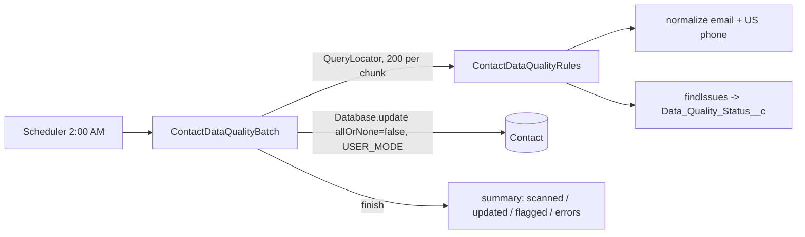

# Apex Batch Data Quality Job (normalize + flag Contacts, schedulable)


## Business problem

CRM data degrades over time: phone numbers in many formats, mixed-case emails, throwaway email domains, contacts that cannot be reached. This nightly job cleans what can be fixed safely, flags what needs a human, and clears the flag once the record is fixed. One bad record never fails the whole run.

## Tech stack

Batch Apex (`Database.Batchable`, `Database.Stateful`), Schedulable, partial-success DML, Salesforce DX, GitHub Actions

## Architecture



## What it demonstrates

- Rules live in a pure class (`ContactDataQualityRules`), so they can be unit-tested without DML.
- Only records that actually changed are updated, which keeps DML and field history small.
- Partial-success DML collects up to 100 errors in stateful counters instead of aborting the chunk.
- Re-running the job clears `Data_Quality_Status__c` once an issue is resolved.
- Tests run 153 synthetic contacts and cover normalization, each flag, re-run clearing, scheduling and phone edge cases.

## Project layout

| Path | Purpose |
| --- | --- |
| `classes/ContactDataQualityBatch.cls` | Batch + Schedulable |
| `classes/ContactDataQualityRules.cls` | Pure rule functions |
| `classes/ContactDataQualityBatchTest.cls` | Tests |
| `objects/Contact/fields/Data_Quality_Status__c` | Flag field |

## Run it yourself

Prerequisites: [Salesforce CLI](https://developer.salesforce.com/tools/salesforcecli), a Dev Hub org (a free Developer Edition org with Dev Hub enabled works), Node.js 20+.

```bash
sf org login web --set-default-dev-hub --alias devhub
sf org create scratch --definition-file config/project-scratch-def.json --alias demo --set-default --duration-days 7
sf project deploy start
sf apex run test --test-level RunLocalTests --code-coverage --result-format human --wait 20

# schedule nightly at 2:00 AM
echo "System.schedule('Contact DQ nightly', '0 0 2 * * ?', new ContactDataQualityBatch());" | sf apex run
```

## CI

`.github/workflows/ci.yml` runs on every push and pull request:

1. **Static checks**: Prettier with the Apex parser (this fails on any Apex syntax error).
2. **Apex tests in a scratch org**: runs only if the repository owner adds a `SFDX_AUTH_URL` secret (Settings > Secrets and variables > Actions). Get the value with `sf org display --verbose --target-org devhub` (the "Sfdx Auth Url" line). **Never commit it.**

## Security notes

- No credentials, endpoints, org IDs or tokens are stored in this repository. `.gitignore` blocks common secret files.
- Apex runs `with sharing`, and queries and DML use `USER_MODE` so object-, field- and record-level security is enforced.

## Limitations and next steps

- Phone normalization handles U.S. numbers only. International numbers are flagged rather than changed.
- The summary goes to the debug log. A production version would write it to a log object or email the job owner.

## About this project

This is an independent portfolio project. It demonstrates patterns I have used on enterprise Salesforce engagements, rebuilt from scratch on the standard data model with synthetic data. It contains no client or employer code, data, object names or configuration. It was developed with AI-assisted tooling and reviewed by me.

## License

MIT. See [LICENSE](LICENSE).

